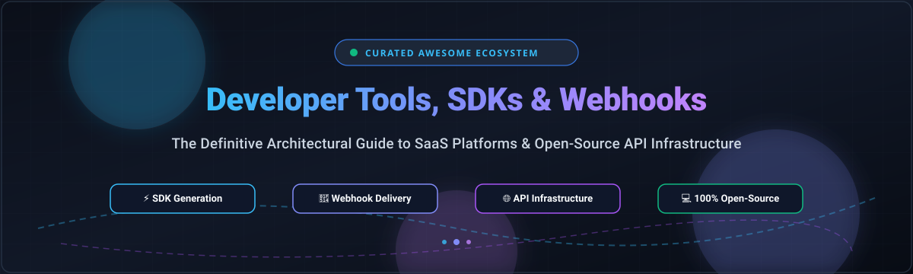

# Awesome-Developer-Tools-SDKS-Webhooks 🚀

  
  
  
  
  
  

  

## 🌟 Top Developer Tools, SDKs & Webhooks Ecosystem

**Curated List of SaaS Platforms & Open-Source GitHub Projects** ⚡  
*Focused on API Infrastructure, SDK Generation & Event-Driven Webhook Delivery* 📡  
**Last updated: March 2026** 📅

This repository tracks notable **SaaS platforms** and **open-source projects** for **Developer Tools, SDKs & Webhooks**. These platforms provide the foundational infrastructure for building, testing, and distributing APIs and client libraries—covering API gateways, SDK generators, webhook delivery engines, and developer documentation that reduce integration friction for third-party developers.

**Category Leaders** include Chargebee, Stripe, Twilio, GitHub, Shopify, Plaid, Brex, Square, AWS Developer Tools, and Postman.

**Open-Source First**: We highlight active projects for self-hosted SDK generation, open-source webhook infrastructure, API testing, and community-driven API gateways—ideal for teams seeking transparency and predictable costs over per-seat or per-event SaaS billing. The open-source landscape is battle-tested: **Hoppscotch** powers API exploration, **Kong** orchestrates API gateways, **OpenAPI Generator** supports 50+ client SDK languages, and **Hook0** / **Outpost** / **Svix** provide full self-hosted webhook delivery.

Contributions welcome! Open a PR to add/update entries. Keep descriptions factual and link to official sites. 🤝

---

## 📑 Table of Contents
- [📊 Sector Overview & Market Dynamics](#-sector-overview--market-dynamics)
- [☁️ SaaS/Hosted Platforms](#️-saashosted-platforms)
- [💻 Open-Source GitHub Projects](#-open-source-github-projects)
- [🤝 How to Contribute](#-how-to-contribute)
- [⚠️ Disclaimer](#️-disclaimer)
- [📈 Star History](#-star-history)
- [💖 Support & Sponsorship](#-support--sponsorship)

---

## 📊 Sector Overview & Market Dynamics

The global developer tools and API infrastructure ecosystem represents an estimated **$10 billion to $50+ billion** market across API management, webhook delivery, cloud APIs, and developer productivity tools (compounding at a robust **~21%–24% CAGR** toward nearly $860B across broader software development tooling by the 2030s). 

Market structure exhibits a **hybrid dynamic**: core hyperscale cloud developer suites and transaction/communication rails (AWS, Microsoft GitHub, Stripe, Twilio) operate in concentrated, high-moat sectors with network effects, while API testing, webhook delivery infrastructure, and SDK generation remain **moderately fragmented** with intense competition between VC-backed developer tooling startups and self-hosted open-source alternatives.

---

## ☁️ SaaS/Hosted Platforms

*Sorted by Company Scale (Valuation / Annual Revenue Run Rate - Descending)* 🏢

| Product | Valuation / Revenue Scale | Description | Pricing (Starting Tier) | Free Tier / Trial Limits |
|---|---|---|---|---|
| **[AWS Developer Tools](https://aws.amazon.com/products/developer-tools/)** | **~$160B+ ARR** (Part of Amazon multi-trillion market cap) | Cloud CI/CD and developer suite including CodeBuild, CodePipeline, CodeDeploy, and CodeCommit. Built for hyperscale cloud workflows. | CodeBuild: **$0.005/build minute** (general1.small); CodePipeline: **$1.00/active pipeline/month**; CodeDeploy: **$0.00** for EC2/Lambda/ECS | **Free forever (AWS Free Tier)**: CodeBuild includes **100 build minutes/month** (general1.small); CodePipeline includes **1 free active pipeline/month**; CodeDeploy is free for all AWS cloud compute targets |
| **[Stripe](https://stripe.com/)** | **$159B Valuation** (~$6.8B ARR) | Payments platform with **REST API** organized around predictable resource-oriented URLs. **OpenAPI published on GitHub** with frequent releases. **11 first-party SDKs** (Node, Python, Ruby, Go, Java, .NET, PHP, iOS, Android, React Native, React). **200+ signed webhook event types**; delivery is at-least-once and can re-order—handlers must be idempotent. | Standard: **2.9% + $0.30** per successful card charge (no monthly account fee or setup fee) | **Free forever**: 100% free unlimited sandbox/test mode access with test API keys; production charges strictly per transaction |
| **[Shopify](https://shopify.dev/)** | **~$110B+ Market Cap** (~$11.56B ARR) | Commerce platform with **GraphQL-First architecture** (Admin API and Storefront API). **Webhooks** for orders/create, inventory_levels/update, refunds/create, plus mandatory compliance webhooks (customers/data_request, customers/redact, shop/redact). Cost-based rate limiting with leaky bucket. | Developer / Partner: **$0/month**; Merchant Starter plan: **$5/month**; Basic plan: **$39/month** | **Free forever (Shopify Partner)**: unlimited development stores with full GraphQL/REST API access and test webhooks; Merchant store offers **3-day free trial** |
| **[Square](https://developer.squareup.com/)** | **~$40B+ Market Cap (Block)** (~$24B ARR) | Payments platform with REST API for payments, catalog, customers, and invoices. Official SDKs and developer dashboard sandbox environment. Charges per processed payment with idempotency key support. | Standard processing: **2.6% + 10¢** (in-person) or **2.9% + 30¢** (online payments); no monthly platform API fee | **Free forever**: unlimited sandbox developer environment with simulated bank/card endpoints; production charges strictly per transaction |
| **[Twilio](https://www.twilio.com/)** | **~$15B+ Market Cap** (~$5.07B ARR) | Communications platform with **1,500+ API endpoints** across SMS, Voice, Video, Email, Verify, and Flex. **AsyncAPI specification** published, SDKs for all major languages, and MCP Server for AI coding agents. | Pay-as-you-go: SMS starts at **$0.0083/message**, Voice starts at **$0.0140/min outbound** ($0.0085/min inbound), local phone numbers from **$1.15/month** | **30-day free trial**: no credit card required; includes product trial units (~100 SMS, 75 voice mins, 3,000 emails) restricted to verified caller IDs and 1 active trial number |
| **[Plaid](https://plaid.com/)** | **~$8B Valuation** (~$500M ARR) | Financial data platform with REST API for bank account linking, transactions, balance, identity, and investments. **Webhooks** for SYNC_UPDATES_AVAILABLE, ITEM: LOGIN_REQUIRED, and ITEM: ERROR with JWT signature verification. Rate limits per-Item per-endpoint. | Sandbox & Development: **$0/month**; Production Pay-as-you-go: Auth starts at **~$1.50 per linked account**, Transactions at **~$0.30/Item/month** | **Free forever**: unlimited Sandbox testing environment + Development environment free for up to **100 live Items** (connected institutions) |
| **[GitHub](https://github.com/features/integrations)** | **$7.5B Acq Valuation** (~$2B+ ARR) | **REST API** and **GraphQL API** for repositories, issues, pull requests, Actions, and more. **GitHub Apps** with granular API permissions and **built-in webhooks**. **Octokit SDK** for TypeScript/Node.js. OpenAPI specification available for code generation. | Free plan: **$0/month**; Team plan: **$4/user/month** (billed annually) or $4.40/user/month; Enterprise: **$21/user/month** | **Free forever**: unlimited public/private repositories, 5,000 API requests/hour (authenticated), 2,000 GitHub Actions minutes/month |
| **[Postman](https://www.postman.com/)** | **$5.6B Valuation** (~$300M ARR) | API development, mock server, testing, and collaboration platform with Postman Collections, Monitors, and Postman CLI. | Free plan: **$0/month**; Solo plan: **$9/month** (billed annually); Team plan: **$19/user/month** (billed annually) | **Free forever**: 1 user seat, unlimited local/cloud mock servers, unlimited collection runs, 1,000 API monitoring calls/month, 50 AI credits/month |
| **[Brex](https://developer.brex.com/)** | **$5.15B Valuation** (~$500M+ ARR) | Financial spend platform with **Webhooks API** for real-time event notifications, multi-destination webhook subscriptions, token rotation, and staging environment. | Essentials plan: **$0/user/month**; Premium plan: **$12/user/month** | **Free forever (Essentials)**: includes corporate cards, spend tracking, and full Brex REST & Webhooks API access; no credit card required for cardless signup |
| **[Chargebee](https://www.chargebee.com/)** | **$3.5B Valuation** (~$250M ARR) | Subscription billing platform with **REST API v2** for subscriptions, customers, invoices, payments, and usage metering. HTTP Basic Auth with site-scoped API keys. Ships **SDKs for 7 languages** (Node.js, Python, PHP, Java, Ruby, Go, .NET), webhooks, sandbox/test mode, and an **MCP server** for AI agents. Rate limits: Starter 150 calls/min, Performance 1,000/min, Enterprise 3,500/min. | Starter: **$0/month** (free up to $250K cumulative billing volume, then 0.75% overage fee); Performance: **$599/month** ($7,188/year) | **Free forever (Starter)**: full access up to $250,000 cumulative billing volume; unlimited sandbox/test account |

---

## 💻 Open-Source GitHub Projects

*Sorted by Star Count (Descending)* ⭐

| Project | Star Badge | Description |
|---|---|---|
| **[Hoppscotch](https://github.com/hoppscotch/hoppscotch)** |  | **Open-source API development ecosystem.** Lightweight, web-first API client alternative to Postman. Supports REST, GraphQL, WebSocket, SSE, and Socket.IO with environment variables, team workspaces, and self-hosted deployment. |
| **[Kong](https://github.com/Kong/kong)** |  | **The cloud-native API gateway & service mesh.** Written in Lua/OpenResty, Kong manages routing, rate limiting, authentication, logging, and webhook proxying with sub-millisecond latency. Supports declarative config and Kubernetes CRDs. |
| **[Swagger UI](https://github.com/swagger-api/swagger-ui)** |  | **OpenAPI interactive visualization & documentation tool.** Renders interactive API documentation directly from OpenAPI (OAS 3.0/3.1) and Swagger specs, allowing developers to execute API calls directly inside the browser. |
| **[OpenAPI Generator](https://github.com/OpenAPITools/openapi-generator)** |  | **The most widely used open-source SDK generator.** Generates client libraries, server stubs, documentation, and configuration from OpenAPI 2.0/3.x specifications across **50+ languages and frameworks** (Java, Python, TypeScript, Go, Rust, C#, PHP, Swift). Apache-2.0. |
| **[Fern](https://github.com/fern-api/fern)** |  | **Input OpenAPI. Output SDKs and Docs.** TypeScript-based SDK generator producing idiomatic SDKs with built-in authentication, automatic retries, pagination, and type-safe error handling. Powers SDK generation pipelines for leading platforms. |
| **[Svix](https://github.com/svix/svix-webhooks)** |  | **Enterprise-grade open-source webhooks-as-a-service.** Built with Rust and Postgres/Redis. Provides signed webhook delivery, automated exponential backoff retries, consumer portal for inspection, rate limiting, and SDKs for sending and verifying webhooks. |
| **[Hook0](https://github.com/hook0/hook0)** |  | **Self-hosted webhook delivery platform with full-feature parity.** SSPL-1.0 licensed. Outbound webhooks with multi-tenant label-based filtering, HMAC signatures, escalating backoff retries, dead letter queue (DLQ), and SDKs across 12+ languages. |
| **[Outpost (Hookdeck)](https://github.com/hookdeck/outpost)** |  | **Production-ready self-hosted outbound webhook & event destination infrastructure.** Apache-2.0, Go/Docker. Dispatches to **Webhooks, AWS EventBridge, SQS, SNS, GCP Pub/Sub, Kafka, and RabbitMQ**. Includes white-label React customer portal and OpenTelemetry metrics. |
| **[Speakeasy](https://github.com/speakeasy-api/speakeasy)** |  | **Open-source developer-first SDK generator.** Generates type-safe SDKs and Terraform providers from OpenAPI specs with CI/CD integration via GitHub Actions. Focuses on developer experience and clean idiomatic code. |
| **[good-webhooks](https://github.com/pplytas/good-webhooks)** |  | **Transactional outbox-pattern webhook library (MIT).** Integrates `publish()` into existing database transactions without a separate outbox table. Implements Standard Webhooks HMAC-SHA256 signing, 8 retry cycles, and manual/batch replay. |

---

### 🛠️ Architecture Blueprint for Custom Developer Platforms

Combine **Fern** or **OpenAPI Generator** for SDK generation from OpenAPI specs, **Kong** for API gateway security and rate limiting, **Hoppscotch** or **Swagger UI** for developer-facing interactive API testing, and **Svix**, **Outpost**, or **Hook0** for robust event-driven webhook dispatching—building a complete, zero-lock-in platform stack without recurring per-seat SaaS costs.

---

## 🤝 How to Contribute

1. Fork the repo 🍴
2. Add/edit entries in `README.md` (maintain tabular structure and star badge format).
3. Include: name, link, concise description, pricing/scale, and licensing.
4. Submit a Pull Request with a clear summary.

---

## ⚠️ Disclaimer

- This is a **community-curated** list — not exhaustive and not an endorsement.
- Developer platforms handle API credentials and potentially sensitive application data; enforce least-privilege scopes, token rotation, and audit logging.
- **Webhook delivery is at-least-once, not exactly-once.** Handlers must be idempotent. Verify webhook signatures (HMAC-SHA256 / Ed25519) before processing events.

---

## 📈 Star History

---

## 💖 Support & Sponsorship

Thank you for exploring and supporting this curated developer ecosystem! 🚀  

If you find this repository helpful for your projects, team, or architecture research, please consider:
- ⭐ **Starring** the repository on GitHub
- 🍴 **Forking** and contributing your favorite developer tools
- 📢 **Sharing** this repository with other developers, platform engineers, and API architects
- ☕ Supporting continuous maintenance and updates via the [GitHub Sponsors Dashboard](https://github.com/sponsors/ishandutta2007)

Every contribution and share is deeply appreciated! 🙌
